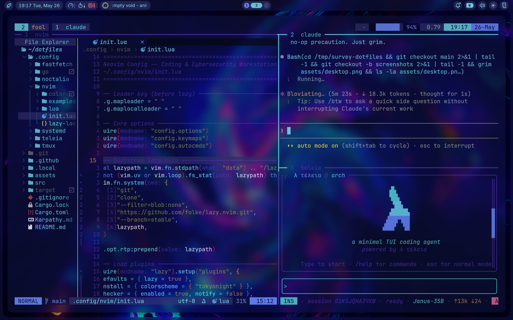
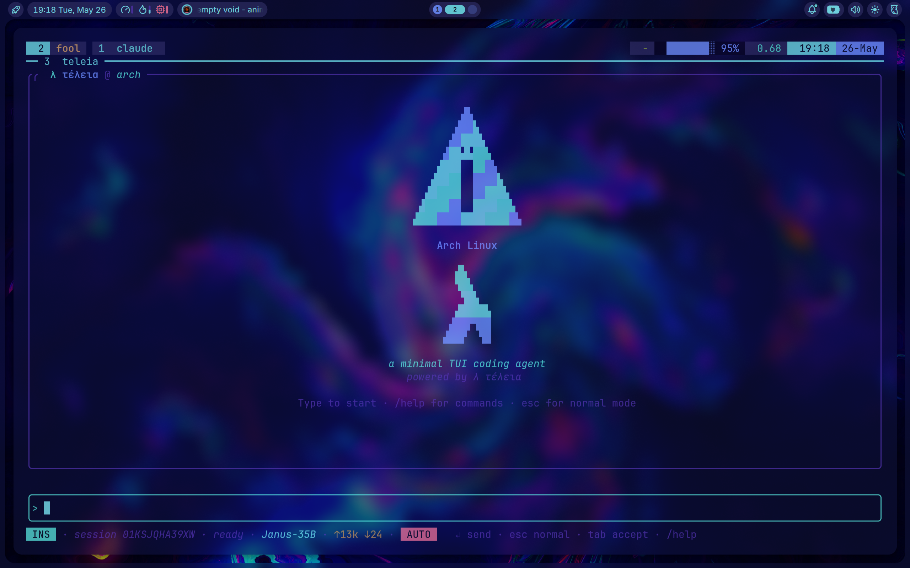
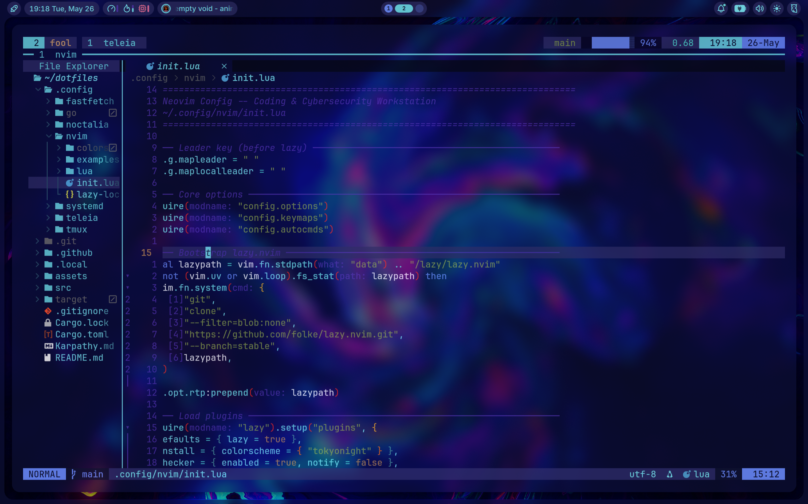
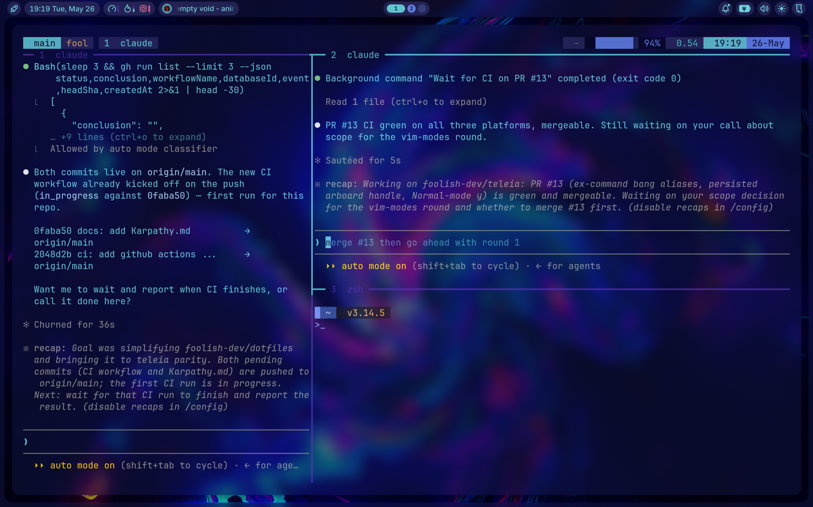
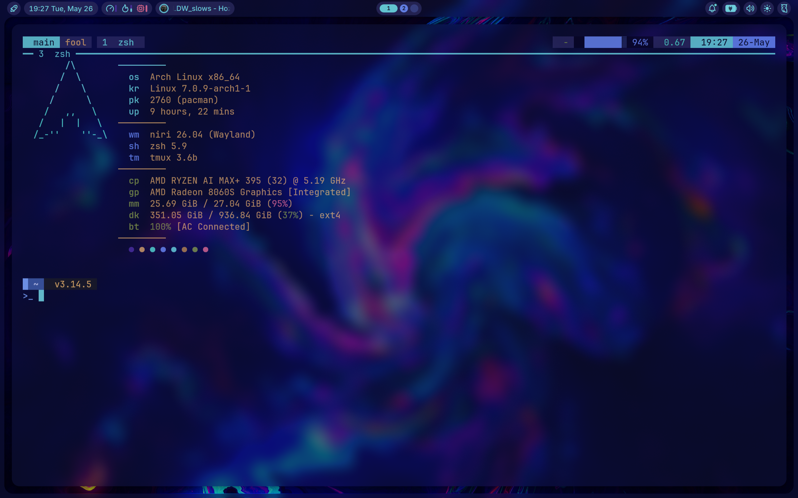

# dotfiles

[](https://github.com/foolish-dev/niri-dotfiles/actions/workflows/ci.yml?query=branch%3Amain)

<p align="center">
  
</p>

An AI coding agent, a wallpaper-driven theming engine, an offensive-security MCP backend, and the editor / multiplexer / shell / banner that round out the desktop — all installed and deployed by a single Rust binary.

## At a glance

| | |
| --- | --- |
| **Binary** | `dotctl` — one Rust crate, three subcommands |
| **Editor** | Neovim with **104 plugins**, **35 LSPs**, 21 formatters/linters, 4 DAP adapters |
| **Agent** | `teleia` wired to **9 MCP servers** (context7 · filesystem · github · fetch · hexstrike-ai · playwright · sequential-thinking · memory · weather) |
| **Offsec** | HexStrike AI on a sandboxed systemd unit + BlackArch repo (5,000+ packages, `pacman -S` away) |
| **Theming** | `grogu` repaints **9 targets** from the current wallpaper, in one shot |
| **Palette** | Grogu — extracted from the current wallpaper, so it changes whenever the wallpaper does |

## Install

> **The base desktop.** `dotctl install` installs the niri base desktop and the curated tools (grogu, teleia, HexStrike, Neovim, tmux, zsh + starship, fastfetch, Noctalia, the greeter); `dotctl deploy` lays down the dotfiles. `deploy` alone installs nothing, so it warns when `niri` is missing — run `dotctl install` (or `dotctl all`) first. For the heavier full bundle (ghostty, GTK/Qt theming, 300+ BlackArch tools), see **[foolish-dev/distro-work](https://github.com/foolish-dev/distro-work)**.

```bash
git clone --depth 1 https://github.com/foolish-dev/niri-dotfiles.git ~/niri-dotfiles \
  && cargo install --path ~/niri-dotfiles --locked && dotctl all
```

Needs `git` and `cargo` (install rustup if you don't have it). The clone is the only copy of the repo you download, and a shallow one: the history still carries the wallpapers this repo used to ship (see below), so `--depth 1` skips ~185 MiB of it. `cargo install --path` builds `dotctl` from it into `~/.cargo/bin`, and `dotctl all` pulls it, rebuilds itself if its own source changed, then runs `install` and `deploy`. (`cargo install --git` would download the whole ~200 MiB repo, wallpapers included, into `~/.cargo/git` to build a 0.2 MiB crate, and `dotctl all` would then clone it a second time.)

Manual:

```bash
git clone https://github.com/foolish-dev/niri-dotfiles.git ~/niri-dotfiles
cd ~/niri-dotfiles
cargo build --release
./target/release/dotctl install   # tools + BlackArch (+ Chaotic AUR on Arch), idempotent
./target/release/dotctl deploy    # symlink .config/* + .local/bin/*, enable hexstrike-server
# or: dotctl all
```

Both `install` and `deploy` are idempotent. `deploy` moves pre-existing non-symlink files to `~/.dotfiles-backup/<unix-ts>/` before replacing them. `--repo <path>` or the `DOTFILES_REPO` env var overrides the default `~/niri-dotfiles` source.

| Subcommand | In one line |
|---|---|
| `dotctl install` | Install every package and tool the tracked configs call |
| `dotctl deploy` | Link the configs into `~`, copy the wallpapers, enable the user units |
| `dotctl all` | Update the repo and `dotctl` itself, then `install` and `deploy` |

**`dotctl install`**

- **Repos:** BlackArch everywhere, plus Chaotic AUR on non-CachyOS hosts (both idempotent), and an AUR helper: `yay` from `[cachyos]` on CachyOS, from Chaotic AUR on Arch, or whichever of `yay`/`paru` is already present.
- **Base desktop** (`pacman -S`): niri, fuzzel and kitty, plus what `config.kdl` and `.zshrc` call: wl-clipboard, wl-clip-persist, cliphist, xwayland-satellite, wireplumber, brightnessctl, zsh, starship, pkgfile (with its daily database timer, which zsh's command-not-found reads) and the JetBrainsMono Nerd font.
- **Tools:** tmux, fastfetch, neovim, lazygit, fwupd, and `noctalia` (Noctalia v5, from Arch `extra`).
- **Our crates** (`cargo install --git`): grogu and teleia. A grogu older than 0.2.0, the first to write Noctalia v5's palette, is rebuilt.
- **For teleia:** clangd, rust-analyzer + `rust-src` (rustup components under rustup), Node.js + npm for the `npx`-launched MCP servers, and GitHub's own `github-mcp-server` (AUR).
- **HexStrike AI:** cloned, its venv built, its server made to bind loopback and answer only loopback names.
- **AUR:** the Bibata cursor theme every tracked config names, `sddm-theme-noctalia-git`, and the polkit agent `noctalia-unofficial-auth-agent-git`, built from a locally patched PKGBUILD (GCC 16 fix).
- **Login:** the noctalia SDDM theme selected via `/etc/sddm.conf.d/` and `sddm.service` enabled, never overriding a third-party display manager; `greetd` + `greetd-regreet` + `cage` with a noctalia-themed ReGreet config under `/etc/greetd/`, kept as a disabled fallback.

**`dotctl deploy`**

- Symlinks the `.config` set (`teleia, nvim, noctalia, fastfetch, tmux, fuzzel, gtk-3.0/4.0, kitty, lazygit, niri, opencode, qt5ct/6ct, starship.toml`), the home dotfiles (`.zshrc, .editorconfig, .gitignore_global`) and every `.local/bin/*`, backing up whatever it displaces.
- Clears the links an older deploy left for anything the repo has since dropped.
- Copies the images in `wallpapers/` into `~/Pictures/Wallpapers` as real files, so a stray `cp` (the greeter's background sync) cannot write back into the repo.
- Deploys the tracked `.gitconfig` through an untracked `~/.gitconfig` include-stub, and seeds the `~/.gitconfig.local` identity.
- Links the user systemd units into a real directory, runs `daemon-reload`, and enables hexstrike-server, `bb-auth.service` and `fwupd-check.timer`, each skipped with a hint when its binary is absent.

**`dotctl all`**

- Clones or pulls the repo. If that changed `dotctl`'s own source, it rebuilds itself (`cargo install --path`) and carries on as the new binary; `install` and `deploy` on their own only warn about a stale one.
- Clones or updates the private `foolish-dev/niri-wallpapers` into `wallpapers/`. That is owner-only: their redistribution was never cleared, so anyone else brings their own to `~/Pictures/Wallpapers`.
- Then runs `install` and `deploy`.

### Secrets

Two keys are read from the login keyring (gnome-keyring's Secret Service) by the program that needs them, when it starts. They are never in a tracked file, and never exported into the session environment, where every process would inherit them. Store each once:

```bash
# teleia's / opencode's GitHub MCP server, via ~/.local/bin/github-mcp
secret-tool store --label='GitHub token (github-mcp-server)' service github-mcp-server
# avante in Neovim
secret-tool store --label='Anthropic API key (avante)' service anthropic
```

For GitHub, a fine-grained token limited to the repos the agent may touch is safer than `gh`'s own, which has `repo` and `workflow` on everything. An exported `GITHUB_PERSONAL_ACCESS_TOKEN` still takes precedence.

## Supported distros

Arch Linux and CachyOS. `dotctl` reads `/etc/os-release` and branches on `ID`:

| | Arch (and `ID_LIKE=arch` derivatives) | CachyOS |
|---|---|---|
| AUR helper | bootstrapped from Chaotic-AUR (`yay`/`paru` are in no Arch official repo) | `pacman -S yay` straight from `[cachyos]` |
| Chaotic-AUR | added — it is the only helper source | skipped; `[cachyos]` already provides yay/paru |
| BlackArch | added (appended last, below every distro repo) | same |
| Noctalia | `noctalia` (v5) from `extra` | same |
| Display manager | dotctl enables `sddm.service` | same, unless another greeter already owns `/etc/greetd/config.toml` |

An unrecognised distro is treated as Arch. On any host without `pacman`, package
steps warn and continue. Pass `--no-aur-helper` to `install`/`all` to stop
dotctl installing an AUR helper for you; AUR-only add-ons are then skipped.

`dotctl` never takes over a login screen somebody else configured: a `greetd`
whose session command is neither `regreet` (ours) nor the stock `agreety` — for
instance CachyOS's `noctalia-greeter` — is left alone, config and unit both.

## Architecture

`dotctl` is the only thing that needs to run. What you end up with: `teleia` driving 9 MCP servers (the `hexstrike-ai` edge is the offsec one), and `grogu` repainting Neovim · tmux · Noctalia · kitty every time the wallpaper changes.

## Showcase

<p align="center">
  
</p>

<p align="center">
  
</p>

<p align="center">
  
</p>

<p align="center">
  
</p>

<p align="center">
  
</p>

## Components

**`dotctl`** is the in-tree Rust binary that replaced the old `install.sh` + `deploy.sh` pair. Clap-derive CLI, anyhow errors, no async runtime. See the subcommand table under [Install](#install).

[**teleia**](https://github.com/foolish-dev/teleia) (τέλεια — "perfect") is a single-binary TUI coding agent. `.config/teleia/config.toml` wires `context7`, `filesystem`, `github`, `fetch`, `hexstrike-ai`, `playwright`, `sequential-thinking`, `memory`, and `weather` — drop-in compatible with any other MCP client. Its `filesystem` server reaches the project folders, not all of `~`. `dotctl install` cargo-installs it from upstream, the same way it installs grogu; before that it was deployed as a keybind and a config with no binary behind them.

[**grogu**](https://github.com/foolish-dev/grogu) extracts a palette from the current wallpaper and writes themed fragments for niri, kitty, ghostty, tmux, Neovim, teleia, Noctalia, the SDDM greeter background, and the keyboard backlight in one shot. `dotctl install` cargo-installs it from upstream.

[**HexStrike AI**](https://github.com/0x4m4/hexstrike-ai) is a Flask MCP backend exposing 150+ offensive-security tools, shipped as a systemd user unit plus the `hexstrike-mcp` stdio bridge MCP clients call. **The API is unauthenticated — `/api/command` executes arbitrary shell as your user — so it must never be reachable off loopback.** The layers, each failing closed:

- **Sandbox:** the unit runs with `ProtectSystem=strict`, `ProtectHome=read-only`, `PrivateTmp`, `NoNewPrivileges`, and an `InaccessiblePaths=` mask over the credential stores a file-read primitive goes for first — `.ssh`, `.gnupg`, `.claude`, the login keyring, the cloud CLI configs.
- **Bind:** upstream hardcodes `app.run(host="0.0.0.0")`, ignoring its own `HEXSTRIKE_HOST`; `dotctl install` rewrites that to honour it, on every run.
- **The bind, checked:** that rewrite is one Rust pattern match against one line of a 17k-line file dotctl doesn't own, so a second, independent guard checks the property itself. `ExecStartPost=` runs `hexstrike-assert-loopback`, which asks `ss` what the main process actually bound and takes the unit back down if the answer is anything but `127.0.0.1`/`[::1]`, or if it cannot be established at all.
- **Host:** a loopback bind does not keep out the browser on the same machine. A web page that DNS-rebinds its own hostname to `127.0.0.1` reaches the port same-origin, so `dotctl install` also inserts a guard (`assets/hexstrike-host-guard.py`) that answers only requests whose `Host` is a loopback name, and `dotctl deploy` will not enable the unit without it.

Do not rely on systemd's `IPAddress*` directives here: a *user* manager cannot install a cgroup BPF firewall, and silently doesn't. The underlying CLI tools live in [BlackArch](https://blackarch.org): `dotctl install` wires its repo via the upstream `strap.sh`, so `pacman -S <tool>` reaches over 5,000 packages.

**Neovim** — lazy.nvim + Mason, kitchen-sink config:

- **104 plugins** lazy-loaded by event, ft, or key.
- **35 LSPs** auto-installed via `mason-lspconfig` — lua, rust, go, python (pyright + ruff), C/C++, zig, every JS/TS framework (ts, vue, svelte, astro, prisma, tailwind, graphql), the IaC set (yaml, terraform, helm, ansible, docker), and the long tail (elixir, kotlin, jdtls, intelephense, solargraph, texlab, marksman). `ocamllsp`, `hls`, `nil_ls`, `cmake` are omitted by default — install opam / ghcup / etc. and append to `lsp.lua` to re-enable.
- **21 formatters + linters** auto-installed via `mason-tool-installer` (stylua, prettierd, ruff, black, shellcheck, hadolint, eslint_d, gofumpt, alejandra, buf, …) and **4 DAP adapters** via `mason-nvim-dap` (codelldb, debugpy, delve, js-debug-adapter). `nvim-lint` silently skips any binary that hasn't landed yet.
- **AI**: `opencode` (built-in teleia popup), `copilot.lua` (inline ghost text, `<M-l>` to accept), `avante`, `codecompanion`.
- **Testing & debug**: `neotest` (python · go · rust · jest · vitest · plenary), `nvim-dap` + `dap-ui` + `dap-virtual-text`, `rustaceanvim`, `crates.nvim`, `go.nvim`, `typescript-tools`, `venv-selector`.
- **Editor**: `flash`, `vim-illuminate`, `nvim-spectre`, `nvim-ufo`, `harpoon` v2, `oil`, `mini.{ai,bracketed,indentscope}`, `yanky`, `undotree`.
- **UI**: `lualine`, `bufferline`, `dropbar` winbar, `noice`, `alpha`, `fidget`, `aerial`, `zen-mode`, `twilight`, `nvim-colorizer`, `rainbow-delimiters`, `treesitter-context`.
- **Sessions & projects**: `persistence.nvim`, `project.nvim`.

Tokyo Night base, repainted live by `grogu` via `colors/grogu.vim` (gitignored). `nvim-treesitter` and `-textobjects` pinned to `master` so the legacy `configs.setup()` API stays available.

**tmux** — `C-a` prefix, Tokyo Night powerline status, RAM-bar fragment under `.config/tmux/scripts/mem.sh`, and a `grogu.conf` slot (gitignored) the wallpaper-driven theme propagator writes to.

[**Noctalia**](https://github.com/noctalia-dev/noctalia) v5 is a Wayland shell: bar, dock, panels, notifications, lock screen, app launcher. `config.toml` selects the `Grogu` palette, which grogu writes to `palettes/Grogu.json` (gitignored, like all of grogu's output) on every wallpaper change and once at first start; it also blurs the wallpaper into niri's overview backdrop and shows the tracked avatar. Bar tuned to transparency-blur (`background_opacity = 0.2` over the compositor blur), with no active-window title.

**fastfetch** — a Tokyo-Night-tinted `config.jsonc` for [fastfetch](https://github.com/fastfetch-cli/fastfetch) — terminal banner with OS, kernel, shell, and color blocks.

## Layout

```
.
├── assets/                                  # README screenshots, the avatar, greetd/ReGreet config + HexStrike Host guard compiled into dotctl
├── wallpapers/                              # gitignored: dotctl all clones the private niri-wallpapers here
├── .config/
│   ├── teleia/config.toml                   # 9 MCP servers
│   ├── nvim/                                # lazy.nvim + Mason, 104 plugins, 35 LSPs
│   ├── tmux/                                # tmux.conf, scripts/mem.sh
│   ├── noctalia/                            # config.toml (v5), avatar.jpg → assets/; grogu writes palettes/Grogu.json
│   ├── fastfetch/config.jsonc               # terminal banner
│   └── systemd/user/                        # deployed as a REAL dir; units symlinked one by one
│       ├── hexstrike-server.service         # :8888, loopback-pinned at install
│       ├── fwupd-check.service              # report-only LVFS check, no sudo
│       └── fwupd-check.timer                # monthly, armed by dotctl deploy
├── .local/bin/
│   ├── hexstrike-mcp                        # stdio bridge for MCP clients
│   ├── github-mcp                           # GitHub's MCP server, token from the keyring
│   ├── hexstrike-assert-loopback            # ExecStartPost= bind check, fails closed
│   └── dotfiles-check                       # health check: links, units, the shell, and what dotctl install set up
├── src/main.rs                              # dotctl — Rust installer/deployer
├── tests/                                   # hermetic suites (bash, one Python), all run in CI
│   ├── hexstrike-assert-loopback.sh         # cases over the bind check
│   ├── mkproj.sh                            # cases over the scaffolder
│   ├── config-syntax.sh                     # parses every tracked config
│   ├── dotfiles-check.sh                    # cases over the health check
│   ├── github-mcp.sh                        # the launcher never starts tokenless, never prints it
│   ├── fwupd-check.sh                       # the firmware notice retries until delivered
│   ├── bin-helpers.sh                       # sddm-theme, gclone, proj, dev, cheat and the rest
│   ├── hexstrike-host-guard.py              # the Host guard against a real Flask
│   └── dotctl-selfupdate.sh                 # dotctl's self-rebuild, on the built binary
├── .github/workflows/ci.yml                 # rust job + shell job (shellcheck, then the suites)
├── .github/workflows/mcp-pins.yml           # weekly: is every pinned MCP server still npm's latest?
├── .github/scripts/check-mcp-pins.py        # what mcp-pins.yml runs
├── Cargo.toml                               # crate manifest (clap-derive + anyhow)
└── Cargo.lock                               # locked
```

## See also

For the full Arch / CachyOS + Niri + BlackArch desktop bundle (kitty, ghostty, lazygit, opencode, 147 BlackArch launcher entries, SDDM themes, 300+ tools), see **[foolish-dev/distro-work](https://github.com/foolish-dev/distro-work)** (formerly `niri-dotfiles`).
